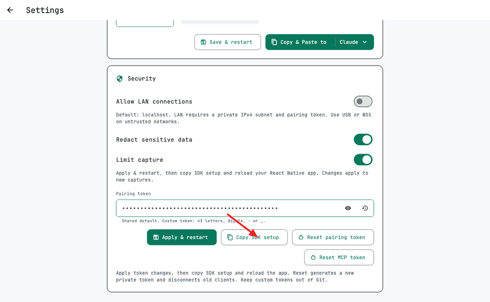
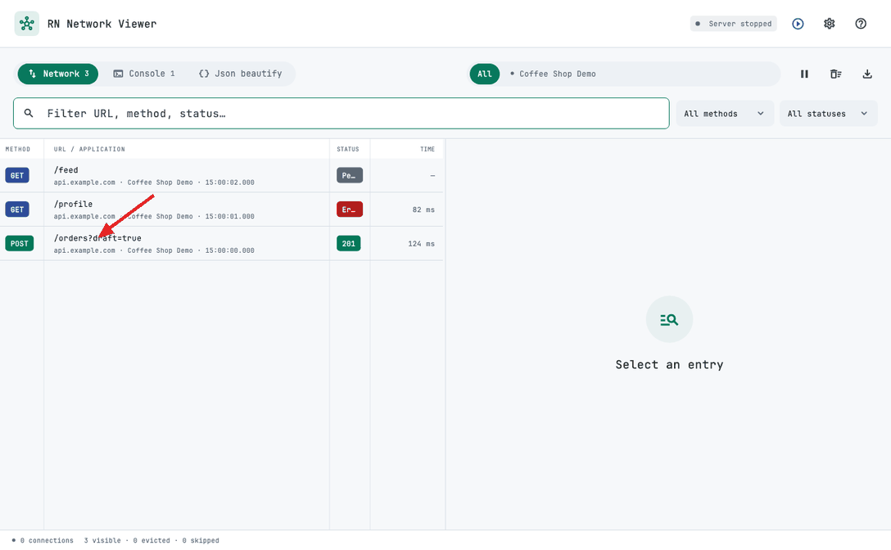
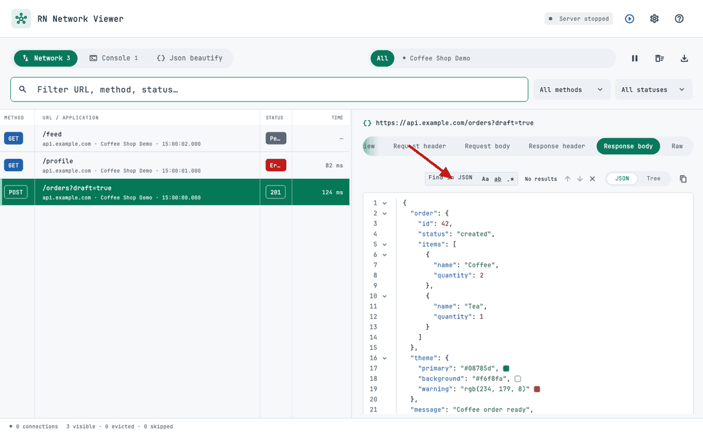
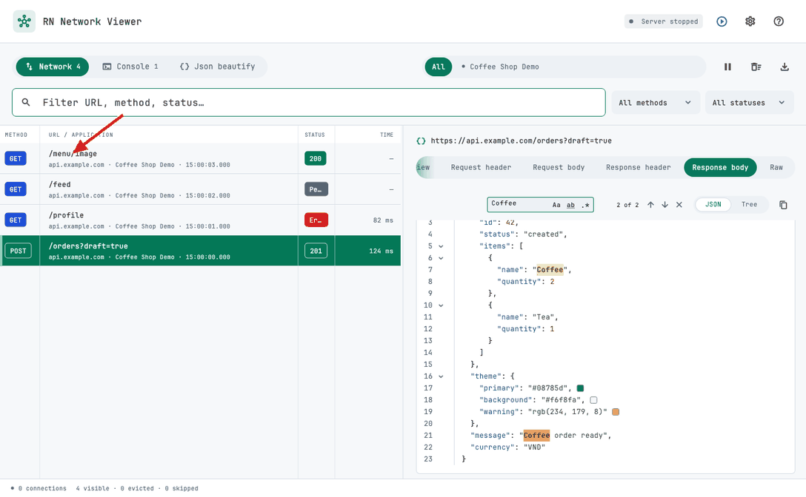
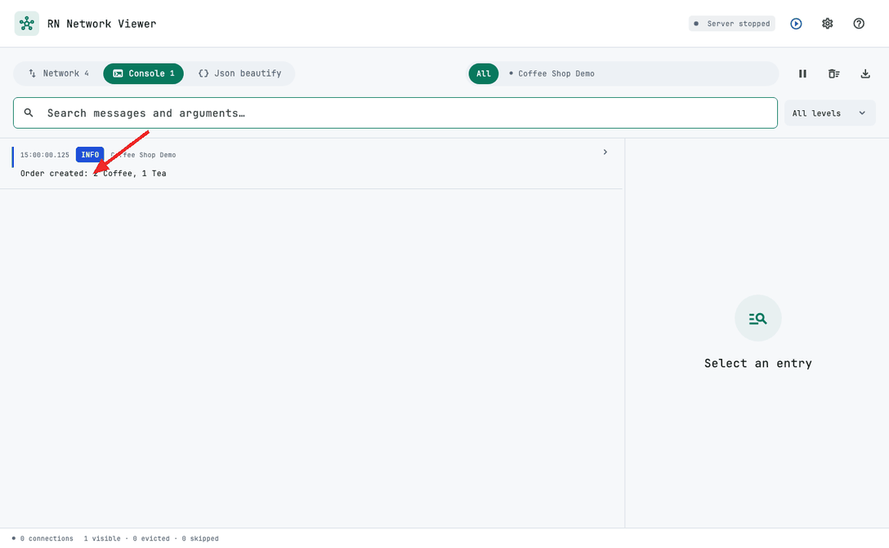
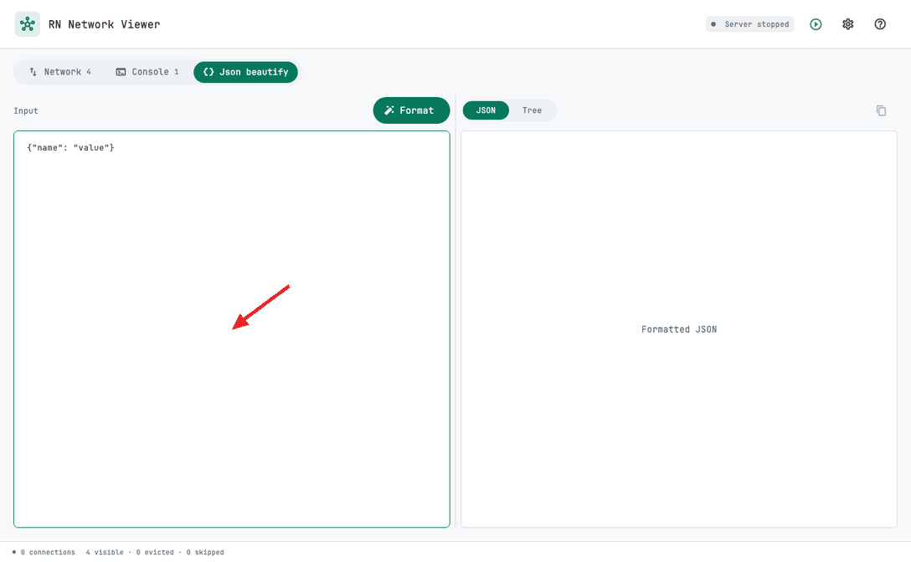
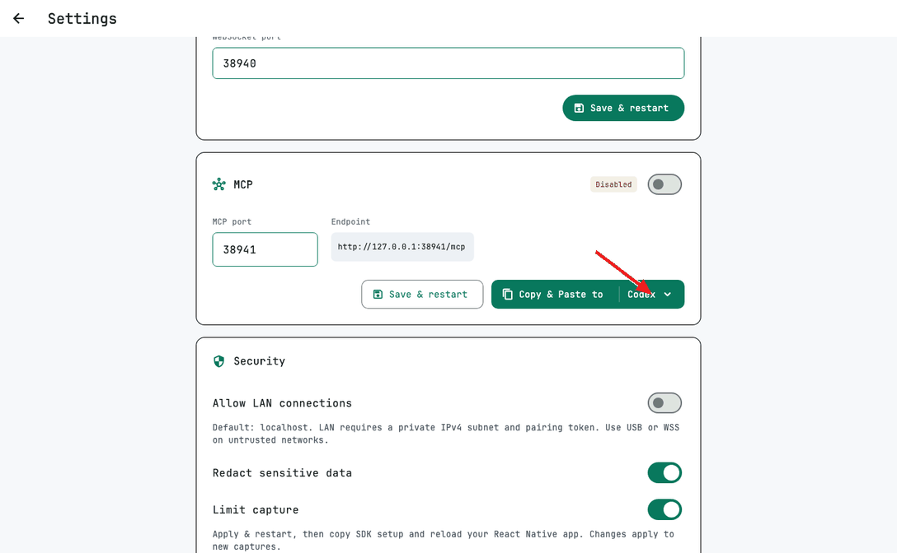
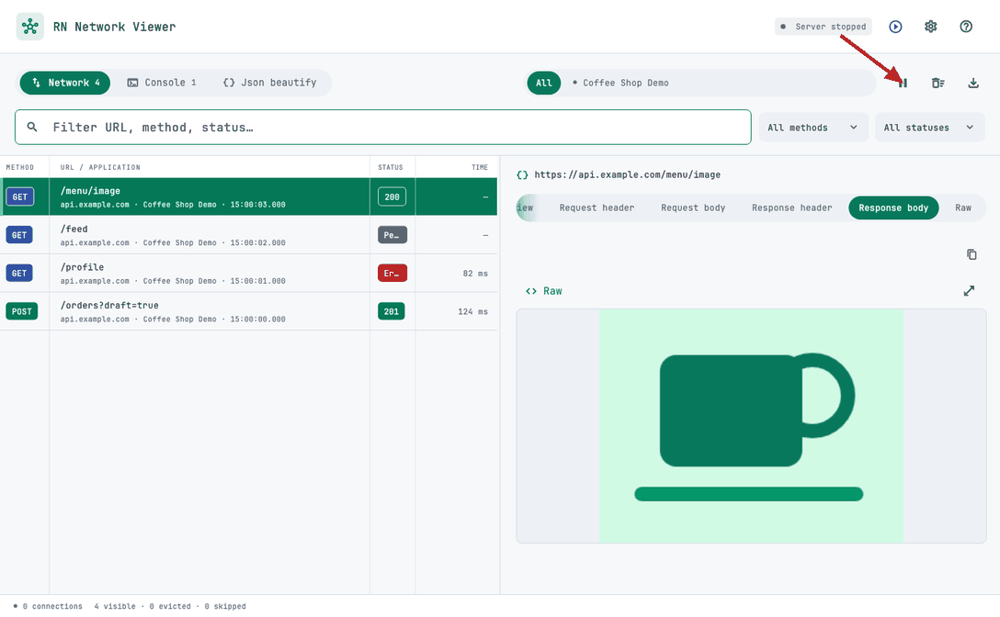

# RN Network Viewer

Ứng dụng desktop cho macOS và Windows để xem network request, response và console log của app React Native. Có công cụ Json beautify và kết nối MCP cho AI đọc dữ liệu đang thu thập.

- [Source và bản phát hành Viewer](https://github.com/DevMobileAn27/rn_network_viewer)
- [Thư viện React Native trên npm](https://www.npmjs.com/package/@quocandev27/rn_network_debugger)

Mỗi mục bên dưới có GIF ngắn minh họa giao diện RN Network Viewer với dữ liệu mẫu **Coffee Shop Demo**. Mũi tên đỏ chỉ thao tác cần thực hiện.

Nhấn biểu tượng **?** ở Home để xem hướng dẫn sử dụng cơ bản hoặc mở **Tham gia thảo luận / Go to Discussion**.

## Mở ứng dụng

1. Tải bản build dành cho hệ điều hành và chip của bạn từ [GitHub Releases](https://github.com/DevMobileAn27/rn_network_viewer/releases).
2. **macOS:** giải nén, kéo `RN Network Viewer.app` vào **Applications** rồi mở app.
3. **Windows:** chạy file `windows-x64-setup.exe` để cài đặt. Nếu dùng bản ZIP, giải nén rồi mở `rn_network_viewer.exe`, giữ nguyên các file và thư mục đi kèm.
4. Kiểm tra trạng thái **Listening :38940** trên thanh công cụ.

### Khi macOS chặn mở app

Sau khi kéo app vào **Applications**, nếu macOS báo không thể xác minh nhà phát triển hoặc app bị hỏng, mở **Terminal** và chạy:

```sh
xattr -dr com.apple.quarantine "/Applications/RN Network Viewer.app"
open "/Applications/RN Network Viewer.app"
```

Lệnh này gỡ thuộc tính quarantine của app. Chỉ dùng với bản tải từ [GitHub Releases chính thức](https://github.com/DevMobileAn27/rn_network_viewer/releases) mà bạn tin cậy.

## Cập nhật ứng dụng

App tự kiểm tra phiên bản mới khi mở. Bạn cũng có thể vào **Settings → App updates → Check for updates**. Dấu tick xanh cạnh phiên bản cho biết app đang mới nhất; khi có bản mới, nút đổi thành **Update new version**. Khi có bản mới, xác nhận trong popup để tải và cài; ứng dụng sẽ đóng rồi mở lại. Chọn **Later/Cancel** để tiếp tục dùng bản hiện tại.

Trên Windows, dùng file **`windows-x64-setup.exe`** để cài app. Các bản cũ chưa có tính năng update cần tải bản hỗ trợ update và cài thủ công lần đầu.

## Kết nối app React Native

Yêu cầu dự án React Native **0.74 trở lên**, chạy ở chế độ development.

### Cài thư viện

```sh
yarn add -D @quocandev27/rn_network_debugger
```

Với iOS, chạy `pod install` trong thư mục `ios`.

1. Mở **Settings → Security → Copy SDK setup** trong Viewer.
2. Dán đoạn khởi tạo vào entry point của app, trước `AppRegistry.registerComponent`. Giữ khối `if (__DEV__)`.
3. SDK và Viewer mới dùng chung token mặc định; có thể bỏ `VIEWER_TOKEN` khi cả hai dùng mặc định. Với token riêng, giữ cấu hình local ngoài Git.
4. Build lại app native rồi gọi API hoặc ghi log.

**Cấu hình bảo mật mới cần nâng cấp cả Viewer lẫn SDK.** Các bản SDK cũ không gửi token sẽ bị từ chối. Xem [hướng dẫn nâng cấp và bảo mật](docs/security.md).



### Chọn kết nối

Mặc định Viewer chỉ nghe tại `127.0.0.1`.

| Thiết bị | Cách kết nối |
| --- | --- |
| iOS Simulator cùng máy Mac | Giữ URL đã copy |
| Android Emulator | Đổi host trong `VIEWER_URL` thành `10.0.2.2` |
| Android qua USB | Chạy `adb reverse tcp:38940 tcp:38940`, giữ host `127.0.0.1` |
| Điện thoại qua Wi-Fi | Bật **Allow LAN connections**, chọn IP máy tính và subnet của mạng, bấm **Apply & restart**, rồi copy lại SDK setup |

Ví dụ subnet: `192.168.1.0/24`; dùng subnet thực tế của mạng, không mặc định mọi mạng đều là `/24`. Cho phép firewall trên interface đã chọn nếu cần.

LAN chỉ chấp nhận địa chỉ nguồn thuộc subnet đã cấu hình. Token mặc định công khai dùng chung; đổi **Settings → Security → Pairing token → Apply & restart** để hạn chế truy cập, rồi copy lại SDK setup. **Use default token** khôi phục mặc định sau khi Apply. Token đã lưu vẫn được giữ khi nâng cấp. `ws://` không mã hóa dữ liệu; dùng mạng tin cậy, USB hoặc [cấu hình WSS](docs/security.md#wss). Không mở port forwarding hoặc public tunnel.

## Chọn ứng dụng

Thanh trên cùng có các tab **Network**, **Console**, **Json beautify**. Bên phải là thanh chọn ứng dụng:

- Chọn **All** để xem dữ liệu của tất cả ứng dụng.
- Chọn một tab ứng dụng để chỉ xem dữ liệu của ứng dụng đó.
- Cuộn ngang thanh tab khi có nhiều ứng dụng kết nối.

## Xem request và response

1. Mở **Network**.
2. Tìm theo URL, method, nguồn capture hoặc trạng thái; dùng **All methods** và **All statuses** để lọc thêm.
3. Chọn một request để mở chi tiết.

| Tab chi tiết | Nội dung |
| --- | --- |
| **Overview** | Thông tin tổng quan, trạng thái, thời gian và query parameters |
| **Request header** | Headers gửi đi |
| **Request body** | Body gửi đi |
| **Response header** | Headers nhận về |
| **Response body** | Body nhận về |
| **Raw** | Dữ liệu gốc của request được chọn |

Method và status có màu riêng để dễ phân biệt. Chọn **Request body** hoặc **Response body** để xem dữ liệu:

- **Body** có tab riêng. Chọn **JSON** để xem nội dung có thụt lề, tô màu và số dòng; bấm mũi tên cạnh số dòng để mở/thu gọn object hoặc array.
- Chọn **Tree** để xem và mở/thu gọn từng nhánh dữ liệu.
- Cuộn ngang để đọc dòng dài. Sao chép nội dung bằng biểu tượng copy; nội dung sao chép vẫn đầy đủ khi có nhánh đang thu gọn.
- Chuỗi màu như `#08785d`, `rgb(...)`, `hsl(...)` có ô preview màu ngay cạnh giá trị.
- Response ảnh, data URI hoặc chuỗi base64 chứa ảnh được nhận diện để xem trực tiếp; dùng **Raw** để xem nội dung gốc.



Mặc định đường chia danh sách/chi tiết nằm giữa cửa sổ; Method và Status dùng độ rộng tối thiểu. Kéo divider giữa các cột hoặc giữa hai panel để điều chỉnh. Vị trí divider ở Network, Console, Json beautify và tab chi tiết đang chọn được ghi nhớ qua lần mở app sau. Đổi request vẫn giữ tab hiện tại. Nhấp đúp divider giữa hai panel để về mặc định. Khi thanh tab chi tiết còn nội dung ngoài khung, gradient xanh lá ở mép gợi ý cuộn ngang. Khi cửa sổ hẹp, chọn request để xem trong cửa sổ nổi.

### Tìm trong JSON

Thanh tìm chỉ xuất hiện với body JSON. Nhập từ khóa, dùng **Aa** (phân biệt hoa thường), **ab** (nguyên từ), `.*` (biểu thức chính quy), mũi tên lên/xuống để chuyển kết quả và **×** để xóa. Bộ đếm hiển thị vị trí như **2 of 3** hoặc **No results**. Tìm kiếm dùng được trong cả JSON và Tree.



### Xem ảnh



## Xem console log

1. Mở **Console**.
2. Tìm theo nội dung hoặc tham số của log.
3. Dùng **All levels** để lọc `log`, `info`, `warn`, `error` hoặc `debug`.
4. Chọn một dòng để xem chi tiết. Mở các nhánh trong **Arguments** để xem object và array.



## Json beautify

1. Mở **Json beautify**.
2. Dán JSON vào **Input**.
3. Bấm **Format**, hoặc nhấn **⌘ Enter** trên macOS / **Ctrl Enter** trên Windows.
4. Chọn **JSON** hoặc **Tree** để xem kết quả. Dùng thanh tìm như ở body JSON và biểu tượng copy để sao chép JSON đã định dạng.



Trong chế độ **JSON**, bấm mũi tên cạnh số dòng để mở/thu gọn object hoặc array. Nếu input không hợp lệ, popup hiển thị lỗi và vị trí dòng/cột; bạn có thể sửa input và Format lại.

Kéo đường chia giữa input và kết quả để điều chỉnh độ rộng. Nhấp đúp để chia đều hai bên. Công cụ này dùng được ngay cả khi chưa có app React Native kết nối.

## Kết nối AI qua MCP

MCP mặc định **tắt**. Kết nối AI như sau:

1. Mở **Settings → MCP**, bật công tắc ở tiêu đề.
2. Kiểm tra trạng thái **Listening** và địa chỉ **Endpoint**. Cổng MCP mặc định là `38941`.
3. Mặc định client là **Codex**. Bấm tên client hoặc mũi tên để chọn **Codex / Claude**, sau đó bấm **Copy & Paste to**. Khi hiện thông báo sao chép thành công, dán vào AI tương ứng để thiết lập kết nối.
4. Giữ Viewer mở, chạy app React Native và yêu cầu AI đọc dữ liệu.



Menu bên phải chọn client; thao tác chọn không tự sao chép. Nếu đổi **MCP port**, bấm **Save & restart**, sau đó cập nhật cấu hình ở client AI.

Cấu hình đã copy có token MCP riêng. Giữ cấu hình này riêng tư; sau khi **Reset MCP token**, copy và cập nhật lại client AI.

Client AI cần chạy trên cùng máy tính. Với client chỉ hỗ trợ stdio, **Copy & Paste to → Claude** có cấu hình dùng `mcp-remote`, cần Node.js. ChatGPT web/cloud không truy cập trực tiếp được endpoint localhost này; cần client hỗ trợ MCP cục bộ.

Ví dụ yêu cầu AI:

- “Xem request đăng nhập mới nhất và phân tích response.”
- “Tìm các request lỗi hoặc mất hơn 2 giây.”
- “Kiểm tra console error của ứng dụng đang kết nối.”

AI có thể dùng `list_sessions`, `list_requests`, `get_request`, `list_logs` và `get_capture_summary` để đọc dữ liệu đã thu thập. Các tool chỉ đọc; tắt công tắc MCP để ngắt truy cập.

## Tạm dừng, xóa và xuất dữ liệu

Các nút trên thanh công cụ:

| Thao tác | Cách dùng |
| --- | --- |
| **Pause / Resume** | Tạm dừng/tiếp tục nhận dữ liệu; dữ liệu phát sinh trong lúc tạm dừng bị bỏ qua |
| **Clear** | Xóa request và log hiện có của tất cả ứng dụng |
| **Export** | Lưu file JSON gồm dữ liệu đang giữ của tất cả ứng dụng, kể cả các mục bị ẩn bởi bộ lọc |



Khi **Limit capture** bật (mặc định), Viewer giữ tối đa 5.000 request/log và khoảng 64 MiB dữ liệu capture; các mục cũ được bỏ dần khi chạm giới hạn. Xuất dữ liệu trước khi đóng app nếu cần giữ lại lịch sử. MCP cũng đọc dữ liệu hiện đang được Viewer giữ.

## Cài đặt

Nhấn biểu tượng **bánh răng** để mở **Settings**.

| Cài đặt | Lựa chọn / mặc định |
| --- | --- |
| **Language** | English hoặc Tiếng Việt; mặc định **English** |
| **Theme** | Light (Sáng) hoặc Dark (Đêm); mặc định **Light** |
| **WebSocket port** | Cổng nhận dữ liệu từ app React Native; mặc định `38940` |
| **MCP** | Mặc định tắt; localhost, token riêng, cổng `38941` |
| **Security** | LAN mặc định tắt; subnet, token, che dữ liệu và giới hạn capture |


Thông báo hiển thị ở góc trái bên dưới: thông tin (xanh dương), thành công (xanh lá), lỗi (đỏ), cảnh báo (vàng). Bấm **OK** để đóng, hoặc **Confirm / Cancel** với thông báo cần xác nhận.

Ngôn ngữ, giao diện, cổng, cấu hình bảo mật và lựa chọn bật MCP được ghi nhớ cho lần mở sau. Ngôn ngữ và giao diện áp dụng ngay.

Để đổi cổng kết nối React Native, nhập **WebSocket port** mới và bấm **Save & restart**. Đổi cổng trong đoạn khởi tạo SDK cho trùng với Viewer rồi Reload app. Với Android qua USB, chạy lại `adb reverse` theo cổng mới.

### Tùy chọn capture

Trong **Settings → Security** có hai công tắc độc lập, mặc định bật:

- **Redact sensitive data / Che dữ liệu nhạy cảm**: bật để che token/password/header nhạy cảm; tắt để giữ nguyên dữ liệu.
- **Limit capture / Giới hạn capture**: bật để giới hạn dung lượng/nội dung và lịch sử; tắt để bỏ các giới hạn capture do SDK/Viewer đặt ra.

Bấm **Apply & restart → Copy SDK setup**, cập nhật cấu hình SDK rồi reload app React Native. Lựa chọn được ghi nhớ; chỉ áp dụng cho capture mới, không khôi phục dữ liệu đã che hoặc cắt. Tắt giới hạn sẽ tăng mức sử dụng bộ nhớ; giới hạn của hệ điều hành/transport vẫn áp dụng.

## Khi chưa thấy dữ liệu

1. Kiểm tra Viewer đang **Listening**. Nếu đang dừng, bấm **Start server**.
2. Kiểm tra app đã cài SDK, thêm đoạn khởi tạo và chạy bản development. Sau khi cài SDK lần đầu, cần build lại app native.
3. Kiểm tra URL, cổng và pairing token; copy lại SDK setup nếu đã đổi token. Với Wi-Fi, kiểm tra hai thiết bị cùng mạng; với Android USB, kiểm tra `adb reverse`.
4. Cho phép quyền Local Network trên macOS hoặc kết nối qua firewall trên Windows nếu được hỏi.
5. Reload app React Native rồi thực hiện lại thao tác gọi API hoặc ghi log.
6. Chọn **All**, xóa từ khóa tìm kiếm và đưa các bộ lọc về **All**; kiểm tra Viewer không ở trạng thái Pause.
7. Nếu cổng bị chiếm, đổi cổng trong Settings và cập nhật cấu hình SDK hoặc MCP client tương ứng.

## Bảo mật và chất lượng

Xem [chính sách báo lỗi bảo mật](SECURITY.md), [giới hạn bảo mật và cấu hình WSS](docs/security.md), và [workflow kiểm thử/build](.github/workflows/desktop.yml). Badge hoặc workflow chỉ là bằng chứng khi lần chạy tương ứng đã thành công; dự án chưa có kiểm toán bảo mật độc lập.
