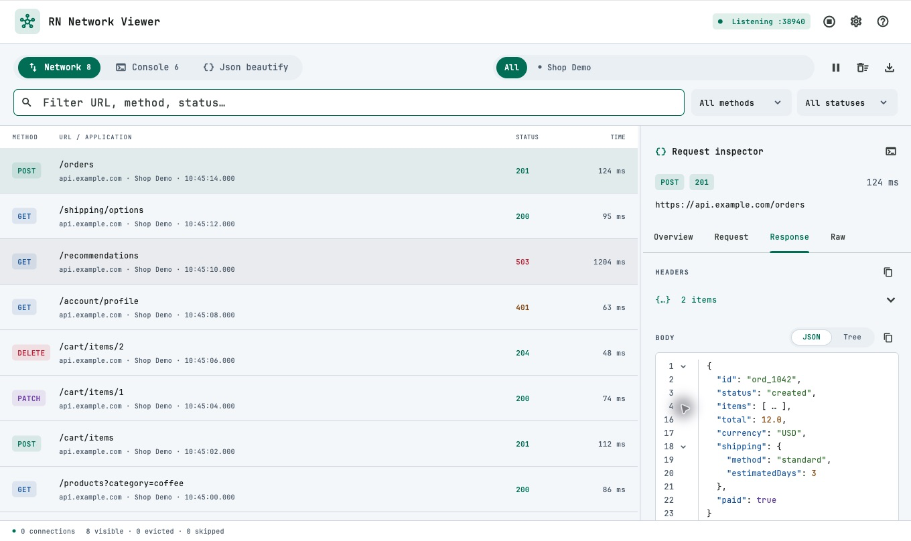
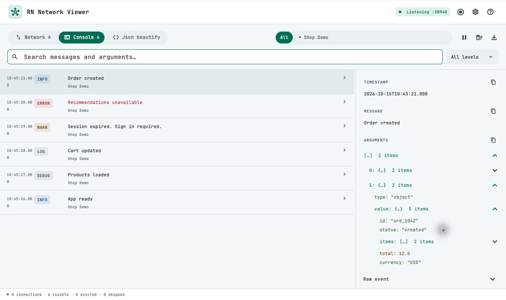
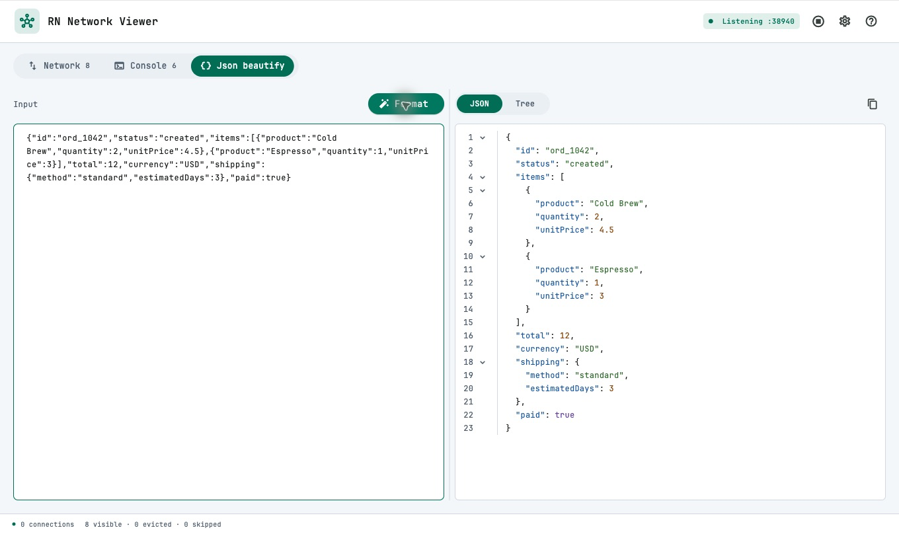
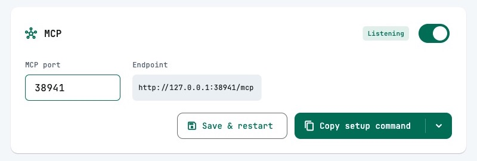
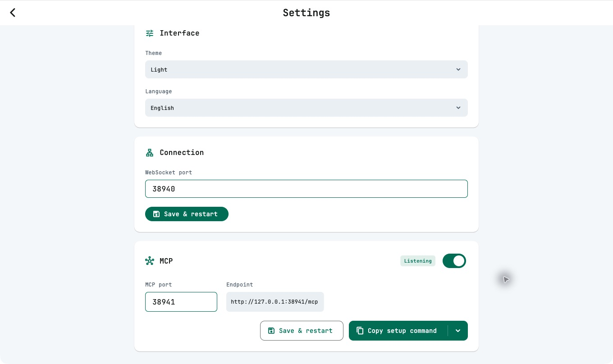

# RN Network Viewer

Ứng dụng desktop cho macOS và Windows để xem network request, response và console log của app React Native. Có công cụ Json beautify và kết nối MCP cho AI đọc dữ liệu đang thu thập.

- [Source và bản phát hành Viewer](https://github.com/DevMobileAn27/rn_network_viewer)
- [Thư viện React Native trên npm](https://www.npmjs.com/package/@quocandev27/rn_network_debugger)

Ảnh minh họa được chụp trực tiếp từ app trên macOS, giao diện sáng, với dữ liệu mẫu **Shop Demo**.



## Mở ứng dụng

1. Giải nén bản build dành cho hệ điều hành của bạn.
2. **macOS:** kéo `RN Network Viewer.app` vào **Applications** rồi mở app.
3. **Windows:** mở file `.exe` trong thư mục đã giải nén, giữ nguyên các file và thư mục đi kèm.
4. Kiểm tra trạng thái **Listening :38940** trên thanh công cụ.

## Kết nối app React Native

Yêu cầu dự án React Native **0.74 trở lên**, chạy ở chế độ development.

### Cài thư viện

Trong dự án React Native:

```sh
yarn add @quocandev27/rn_network_debugger
```

Với iOS, chạy thêm trong thư mục `ios`:

```sh
pod install
```

Thêm đoạn sau vào file khởi chạy, trước `AppRegistry.registerComponent`:

```js
import {bootRNNetworkDebuggerWithPort} from '@quocandev27/rn_network_debugger';

if (__DEV__) {
  bootRNNetworkDebuggerWithPort(38940);
}
```

Mở Viewer, sau đó build và chạy lại app React Native. Thực hiện một thao tác gọi API hoặc ghi console log để bắt đầu xem dữ liệu.

### Chỉ định địa chỉ kết nối

Nếu chưa kết nối được, nhấn biểu tượng **?** trên thanh công cụ Viewer để xem địa chỉ máy tính, rồi thay đoạn khởi tạo bằng:

```js
import {bootRNNetworkDebugger} from '@quocandev27/rn_network_debugger';

if (__DEV__) {
  bootRNNetworkDebugger({
    VIEWER_HOST: '192.168.1.10',
    VIEWER_PORT: 38940,
  });
}
```

Chọn `VIEWER_HOST` theo thiết bị:

| Thiết bị | `VIEWER_HOST` |
| --- | --- |
| iOS Simulator trên cùng máy Mac | `127.0.0.1` |
| Android Emulator trên cùng máy tính | `10.0.2.2` |
| Điện thoại qua Wi-Fi | IP LAN của máy tính chạy Viewer, ví dụ `192.168.1.10` |
| Android qua USB | `127.0.0.1`, sau khi chạy lệnh bên dưới |

Với Android qua USB:

```sh
adb reverse tcp:38940 tcp:38940
```

Với Wi-Fi, điện thoại và máy tính cần cùng mạng. Reload app React Native sau khi đổi địa chỉ hoặc cổng. Xem thêm cấu hình SDK tại [trang thư viện](https://www.npmjs.com/package/@quocandev27/rn_network_debugger).

## Chọn ứng dụng

Thanh trên cùng có các tab **Network**, **Console**, **Json beautify**. Bên phải là thanh chọn ứng dụng:

- Chọn **All** để xem dữ liệu của tất cả ứng dụng.
- Chọn một tab ứng dụng để chỉ xem dữ liệu của ứng dụng đó.
- Cuộn ngang thanh tab khi có nhiều ứng dụng kết nối.

## Xem request và response

1. Mở **Network**.
2. Tìm theo URL, method, nguồn capture hoặc trạng thái; dùng **All methods** và **All statuses** để lọc thêm.
3. Chọn một request để mở chi tiết.

| Tab chi tiết | Nội dung |
| --- | --- |
| **Overview** | Thông tin tổng quan, trạng thái, thời gian và query parameters |
| **Request** | Headers và Body gửi đi |
| **Response** | Headers và Body nhận về |
| **Raw** | Dữ liệu gốc của request được chọn |

Method và status có màu riêng để dễ phân biệt. Trong **Request** và **Response**:

- **Headers** mặc định thu gọn; nhấn mũi tên để mở.
- **Body** hiển thị trực tiếp bên dưới. Chọn **JSON** để xem nội dung có thụt lề, tô màu và số dòng; bấm mũi tên cạnh số dòng để mở/thu gọn object hoặc array.
- Chọn **Tree** để xem và mở/thu gọn từng nhánh dữ liệu.
- Cuộn ngang để đọc dòng dài. Sao chép nội dung bằng biểu tượng copy; nội dung sao chép vẫn đầy đủ khi có nhánh đang thu gọn.
- Nhấn biểu tượng terminal ở đầu khung chi tiết để **Copy as cURL**.

Kéo đường chia giữa danh sách và chi tiết để điều chỉnh độ rộng. Nhấp đúp để trở về độ rộng mặc định. Khi cửa sổ hẹp, chọn request để xem chi tiết trong cửa sổ nổi.

## Xem console log

1. Mở **Console**.
2. Tìm theo nội dung hoặc tham số của log.
3. Dùng **All levels** để lọc `log`, `info`, `warn`, `error` hoặc `debug`.
4. Chọn một dòng để xem chi tiết. Mở các nhánh trong **Arguments** để xem object và array.



## Json beautify

1. Mở **Json beautify**.
2. Dán JSON vào **Input**.
3. Bấm **Format**, hoặc nhấn **⌘ Enter** trên macOS / **Ctrl Enter** trên Windows.
4. Chọn **JSON** hoặc **Tree** để xem kết quả. Dùng biểu tượng copy để sao chép JSON đã định dạng.



Trong chế độ **JSON**, bấm mũi tên cạnh số dòng để mở/thu gọn object hoặc array. Nếu input không hợp lệ, popup hiển thị lỗi và vị trí dòng/cột; bạn có thể sửa input và Format lại.

Kéo đường chia giữa input và kết quả để điều chỉnh độ rộng. Nhấp đúp để chia đều hai bên. Công cụ này dùng được ngay cả khi chưa có app React Native kết nối.

## Kết nối AI qua MCP

MCP mặc định **tắt**. Kết nối AI như sau:

1. Mở **Settings → MCP**, bật công tắc ở tiêu đề.
2. Kiểm tra trạng thái **Listening** và địa chỉ **Endpoint**. Cổng MCP mặc định là `38941`.
3. Bấm **Copy setup command**, rồi dán vào AI để thiết lập kết nối. Nội dung bao gồm endpoint hiện tại, lệnh cho Claude Code/Codex CLI và cấu hình cho client khác.
4. Giữ Viewer mở, chạy app React Native và yêu cầu AI đọc dữ liệu.



Mũi tên bên phải nút sao chép có thêm **Copy JSON config** và **Copy Codex config**. Nếu đổi **MCP port**, bấm **Save & restart**, sau đó cập nhật cấu hình ở client AI.

Với cổng mặc định, có thể thêm trực tiếp qua terminal:

```sh
# Claude Code
claude mcp add --transport http --scope user rn-network-viewer http://127.0.0.1:38941/mcp

# Codex CLI
codex mcp add rn-network-viewer --url http://127.0.0.1:38941/mcp
```

Client hỗ trợ cấu hình JSON cho HTTP MCP:

```json
{
  "mcpServers": {
    "rn-network-viewer": {
      "url": "http://127.0.0.1:38941/mcp"
    }
  }
}
```

Với Codex, cấu hình TOML tương ứng:

```toml
[mcp_servers.rn-network-viewer]
url = "http://127.0.0.1:38941/mcp"
```

Client AI cần chạy trên cùng máy tính. Với client chỉ hỗ trợ stdio, **Copy setup command** có cấu hình dùng `mcp-remote`, cần Node.js. ChatGPT web/cloud không truy cập trực tiếp được endpoint localhost này; cần client hỗ trợ MCP cục bộ.

Ví dụ yêu cầu AI:

- “Xem request đăng nhập mới nhất và phân tích response.”
- “Tìm các request lỗi hoặc mất hơn 2 giây.”
- “Kiểm tra console error của ứng dụng đang kết nối.”

AI có thể dùng `list_sessions`, `list_requests`, `get_request`, `list_logs` và `get_capture_summary` để đọc dữ liệu đã thu thập. Các tool chỉ đọc; tắt công tắc MCP để ngắt truy cập.

## Tạm dừng, xóa và xuất dữ liệu

Các nút trên thanh công cụ:

| Thao tác | Cách dùng |
| --- | --- |
| **Pause / Resume** | Tạm dừng/tiếp tục nhận dữ liệu; dữ liệu phát sinh trong lúc tạm dừng bị bỏ qua |
| **Clear** | Xóa request và log hiện có của tất cả ứng dụng |
| **Export** | Lưu file JSON gồm dữ liệu đang giữ của tất cả ứng dụng, kể cả các mục bị ẩn bởi bộ lọc |

Viewer giữ tối đa 5.000 request/log và khoảng 64 MiB dữ liệu capture; các mục cũ được bỏ dần khi chạm giới hạn. Xuất dữ liệu trước khi đóng app nếu cần giữ lại lịch sử. MCP cũng đọc dữ liệu hiện đang được Viewer giữ.

## Cài đặt

Nhấn biểu tượng **bánh răng** để mở **Settings**.

| Cài đặt | Lựa chọn / mặc định |
| --- | --- |
| **Language** | English hoặc Tiếng Việt; mặc định **English** |
| **Theme** | Light (Sáng) hoặc Dark (Đêm); mặc định **Light** |
| **WebSocket port** | Cổng nhận dữ liệu từ app React Native; mặc định `38940` |
| **MCP** | Mặc định tắt; cổng `38941` |



Ngôn ngữ, giao diện, cổng và lựa chọn bật MCP được ghi nhớ cho lần mở sau. Ngôn ngữ và giao diện áp dụng ngay.

Để đổi cổng kết nối React Native, nhập **WebSocket port** mới và bấm **Save & restart**. Đổi cổng trong đoạn khởi tạo SDK cho trùng với Viewer rồi Reload app. Với Android qua USB, chạy lại `adb reverse` theo cổng mới.

## Khi chưa thấy dữ liệu

1. Kiểm tra Viewer đang **Listening**. Nếu đang dừng, bấm **Start server**.
2. Kiểm tra app đã cài SDK, thêm đoạn khởi tạo và chạy bản development. Sau khi cài SDK lần đầu, cần build lại app native.
3. Kiểm tra host và cổng. Với Wi-Fi, kiểm tra hai thiết bị cùng mạng; với Android USB, kiểm tra `adb reverse`.
4. Cho phép quyền Local Network trên macOS hoặc kết nối qua firewall trên Windows nếu được hỏi.
5. Reload app React Native rồi thực hiện lại thao tác gọi API hoặc ghi log.
6. Chọn **All**, xóa từ khóa tìm kiếm và đưa các bộ lọc về **All**; kiểm tra Viewer không ở trạng thái Pause.
7. Nếu cổng bị chiếm, đổi cổng trong Settings và cập nhật cấu hình SDK hoặc MCP client tương ứng.
